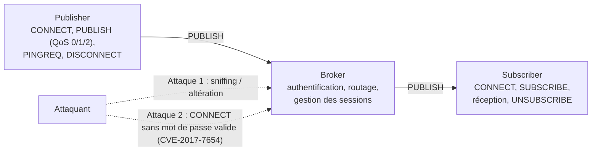

<div align="center">

# MQTT v3.1.1 : Vérification formelle sous UPPAAL

**Modélisation d'un système Publisher / Broker / Subscriber, d'une attaque réelle (CVE-2017-7654) et de sa contre-mesure.**


</div>

---

## En bref

Ce dépôt contient **4 modèles UPPAAL** (automates temporisés) qui permettent de **prouver** ce qu'un attaquant peut (ou ne peut pas) faire sur un broker MQTT :

1. Le fonctionnement normal du protocole
2. Un attaquant qui écoute et altère les messages
3. Une attaque inspirée de **CVE-2017-7654** (connexion sans authentification valide)
4. La même attaque, **bloquée** par une vérification du mot de passe

## Architecture modélisée



## Les modèles

| Fichier | Scénario | Ce qu'on démontre |
|---|---|---|
| `modèle nominal.xml` | Fonctionnement normal | Connexion, publication (QoS 0/1/2), abonnement, keep-alive, déconnexion, sans deadlock |
| `attaque1 sniffing.xml` | Sniffing (interception / altération) | Un attaquant intercepte et falsifie des messages quand TLS n'est pas effectif |
| `attaque2 CVE.xml` | CVE-2017-7654, sans protection | L'attaquant se connecte **sans mot de passe valide** (`auth_bypass_bug = true`) |
| `modèle avec attaque2 avec sol.xml` | CVE-2017-7654, avec correctif | Le broker compare le mot de passe : l'attaquant est **toujours rejeté** |

**Acteurs modélisés :** `Publisher` · `Broker` · `Subscriber` · `Attacker` / `Atk`

## Utilisation

1. Installer [UPPAAL](https://uppaal.org/) (version académique gratuite).
2. Ouvrir un fichier `.xml` : **File → Open**.
3. Onglet **Simulator** pour jouer le scénario pas à pas.
4. Onglet **Verifier** : sélectionner une requête puis cliquer sur **Check**.
   - vert : propriété satisfaite
   - rouge : propriété non satisfaite

> Pour comparer : lancez les mêmes requêtes d'attaque sur `attaque2 CVE.xml` puis sur `modèle avec attaque2 avec sol.xml`.

## Propriétés vérifiées

| Famille | Exemples de requêtes |
|---|---|
| **Sûreté nominale** | `A[] not deadlock` · `A[] (Pub.Publishing imply pub_authenticated == true)` |
| **Accessibilité** | `E<> Pub.Connected` · `E<> Sub.ReceivingMsg` · `E<> Pub.WaitPubrec` |
| **Attaque (sans solution)** | `E<> atk_authenticated` : l'attaquant s'authentifie sans mot de passe |
| **Sécurité (avec solution)** | `A[] not atk_authenticated` · `E<> atk.Rejected` |

## Structure

```
.
├── modèle nominal.xml
├── attaque1 sniffing.xml
├── attaque2 CVE.xml
├── modèle avec attaque2 avec sol.xml
└── README.md
```

## Références

* [Spécification MQTT v3.1.1 (OASIS)](https://docs.oasis-open.org/mqtt/mqtt/v3.1.1/os/mqtt-v3.1.1-os.html)
* [CVE-2017-7654](https://nvd.nist.gov/vuln/detail/CVE-2017-7654)
* [UPPAAL](https://uppaal.org/)

---

<div align="center">

Si ce projet vous est utile, n'hésitez pas à lui donner une étoile.

</div>
